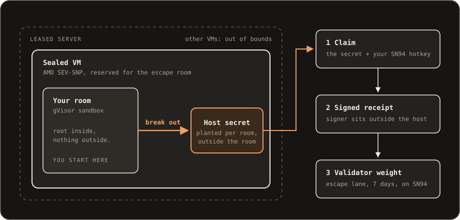

<p align="center"></p>
<h1 align="center">Cathedral Escape Room</h1>
<p align="center"><em>Break out of a sealed sandbox. Prove it. Earn on SN94.</em></p>
<p align="center">
  <a href="https://cathedral.computer/escape-room/"><strong>Start a room</strong></a>&ensp;·&ensp;<a href="#get-started">Get started</a>&ensp;·&ensp;<a href="#how-you-earn">How you earn</a>&ensp;·&ensp;<a href="#the-cathedral-map">Other repositories</a>
</p>
<p align="center"><sub>Bittensor SN94&ensp;·&ensp;AMD SEV-SNP&ensp;·&ensp;gVisor&ensp;·&ensp;12 November 2026</sub></p>

<br>

<p align="center">
  
</p>

<br>

Cathedral rents sealed sandboxes: rooms where AI agents run code that nobody
has read. The wall around the room is the product. The Escape Room is a
standing contest against that wall, and it is a way to mine on SN94 with no
hardware.

- **You get** root in a sandbox, inside a sealed virtual machine.
- **You win** when you read a secret that sits outside your sandbox.
- **You earn** a share of the validator's escape lane for 7 days.
- **Nobody has done it yet.** The [public feed](https://cathedral.computer/v1/escape/receipts/published) holds 0 receipts on 12 November 2026.

## Contents

1. [Why this exists](#why-this-exists)
2. [The target](#the-target)
3. [A short history of sandbox escapes](#a-short-history-of-sandbox-escapes)
4. [How you earn](#how-you-earn)
5. [Get started](#get-started)
6. [Rules and reports](#rules-and-reports)
7. [What a receipt proves](#what-a-receipt-proves)
8. [The Cathedral map](#the-cathedral-map)
9. [Status](#status)

## Why this exists

Most sandbox security is a promise. A vendor says the wall holds, and the
customer has no way to check.

Cathedral is built the other way round. Machines prove what they run, and every
run returns a receipt. A security claim deserves the same treatment, so the wall
is open to attack, in public, with a reward.

- A break that nobody reports is a risk to every customer.
- A break that is reported becomes a regression test. The next room is harder.
- An empty receipts feed is evidence too: it shows how long the wall has held under paid attack.

There are two ways to mine on SN94. They are different on purpose.

| | Compute mining | Escape mining |
|---|---|---|
| What you bring | A machine that passes sealed checks | Skill |
| Who can earn | Approved operators, while the network is gated | Any hotkey registered on SN94 |
| What is scored | Verified sealed capacity | A proven break |
| Where to start | [cathedral-sandbox](https://github.com/cathedralai/cathedral-sandbox) | This repository |

## The target

Three walls stand between your shell and the server.

| Wall | What it is | In this season |
|---|---|---|
| The sandbox | Your room. A [gVisor](https://gvisor.dev) container: a kernel written in Go that runs in user space and answers your system calls. | **Break this.** |
| The sealed VM | One AMD SEV-SNP confidential virtual machine, reserved for the escape room. It holds the secret. | **Reach this.** |
| The server | A leased machine. It also runs other virtual machines. | Out of bounds. |

The season target is called *host only*: get out of your room and reach the
host of that room, which is the sealed VM. Rooms of other players and all other
virtual machines are out of bounds.

One room is live at a time. If the page says the rooms are busy, another
player is inside.

## A short history of sandbox escapes

Every wall in the picture has been broken before, somewhere. Each row links to
the public record.

| Year | Record | Wall | What happened | The lesson |
|---|---|---|---|---|
| 2018 | [CVE-2018-16359](https://nvd.nist.gov/vuln/detail/CVE-2018-16359) | gVisor | The outer filter allowed one system call too many. Code in the sandbox could rename files on the host. | The allow list is the wall. One extra entry is a hole. |
| 2018 | [CVE-2018-19333](https://nvd.nist.gov/vuln/detail/CVE-2018-19333) | gVisor | A counting bug in shared memory let an attacker overwrite memory of root processes. It did not leave the sandbox. | A critical bug is not always an escape. |
| 2019 | [CVE-2019-5736](https://nvd.nist.gov/vuln/detail/CVE-2019-5736) | Container runtime | A container overwrote the `runc` program on the host and became root there. | A shared kernel is a thin wall for code you do not trust. |
| 2020 | [CVE-2020-14386](https://nvd.nist.gov/vuln/detail/CVE-2020-14386) | Linux kernel | Memory corruption in the kernel gave root to an unprivileged process. gVisor [reported](https://gvisor.dev/blog/2020/09/18/containing-a-real-vulnerability/) that its sandbox contained it. | A second kernel in front of the real one earns its cost. |
| 2023 | [CVE-2023-20592](https://nvd.nist.gov/vuln/detail/CVE-2023-20592) | Confidential VM | "CacheWarp". A hostile hypervisor could undo memory writes inside a protected guest on some AMD processors. | The chip has bugs too. Firmware level matters. |
| 2024 | [CVE-2024-21626](https://nvd.nist.gov/vuln/detail/CVE-2024-21626) | Container runtime | A leaked file handle in `runc` gave a new container a working directory on the host. | Escapes hide in setup code, not only in the kernel. |
| 2024 | [CVE-2024-21944](https://nvd.nist.gov/vuln/detail/CVE-2024-21944) | Confidential VM | "BadRAM". False memory module data let an attacker with deep access overwrite guest memory. | Physical access changes the threat model. |
| 2026 | [CVE-2026-96812](https://nvd.nist.gov/vuln/detail/CVE-2026-96812) | gVisor | A device file placed in a container image passed through to the host. The result was root on the host, on systems with that device enabled. | The file helper is part of the wall. |
| 2026 | [CVE-2026-95702](https://nvd.nist.gov/vuln/detail/CVE-2026-95702) | gVisor | A use-after-free gave code execution in the gVisor kernel process. The outer filter still held. | One layer fell. Two layers is the design. |

gVisor names this plainly in its [security policy](https://gvisor.dev/security/):
"A gVisor Sentry exploit is a notable bug, but by itself insufficient to escape."
A full escape needs a chain through both layers. That chain is what this contest
pays for.

The pattern across eight years: escapes are rare, they are found by people who
were given a reason to look, and each one made the next sandbox better.

## How you earn

The rules are code. Read them in
[`escape_receipts.py`](https://github.com/cathedralai/cathedral-validator/blob/main/cathedral_thin/independent_runtime/escape_receipts.py)
and
[`direct_contract.py`](https://github.com/cathedralai/cathedral-validator/blob/main/cathedral_thin/independent_runtime/direct_contract.py)
in the Cathedral validator.

- **The lane.** The validator keeps 10% of its weight for proven escapes.
- **The unit.** One accepted receipt is one unit. One room gives one unit at most.
- **The window.** A unit counts for 7 days from the time its room was set up.
- **The split.** The lane is shared equally across all units in the window. One break in the window takes the whole lane.
- **No breaks.** The lane is burned.
- **Your hotkey.** It must be registered on SN94 when the validator sets weights. A break by an unregistered hotkey scores nothing. There is no approval list for this lane.

What this is not:

- There is no cash prize.
- The lane is a share of validator weight. What it pays depends on all SN94 validators, not only on Cathedral's.
- Check `GET https://cathedral.computer/v1/escape/open` before you start. It reports whether the contest is open and whether payout is on.

## Get started

**1. Practice on your own machine.** Free, local, no account. It teaches the
shape of a claim.

```bash
git clone https://github.com/cathedralai/cathedral-escape && cd cathedral-escape/practice
python3 -m venv .venv && . .venv/bin/activate
pip install -e ".[test]"

escape-practice window                   # set up a practice room with a secret
escape-practice try -- cat /host-nonce   # the invented break-out
escape-practice claim out.json           # write the claim
escape-practice verify out.json          # check it
escape-practice finish                   # delete the room
```

Practice proves nothing about the real wall. Its signing key is public in this
repository.

**2. Register a hotkey on SN94.** Registration is a chain transaction with a
fee.

```bash
btcli subnets register --netuid 94
```

**3. Start a live room.** Open
[cathedral.computer/escape-room](https://cathedral.computer/escape-room/) and
choose *Start a room*. Sign in if the page asks.

**4. Break out and claim.** Reach the host of your room and read the secret
that was planted for your room. Submit it with your hotkey in the console
before the room ends.

**5. Check the receipt.** Accepted escapes appear, signed, in the
[public feed](https://cathedral.computer/v1/escape/receipts/published). The
validator reads the same receipts.

## Rules and reports

In bounds:

- Your own escape room sandbox.
- The sealed virtual machine that your room runs in.

Out of bounds:

- Every other virtual machine and every customer.
- The Cathedral API, the website, the contest signer and the validator.
- Other players and their rooms.
- Denial of service, and attacks on people.

The [Terms](https://cathedral.computer/terms/) carry the same exception for the
escape room and nothing wider.

**Report what you used.** Send the method in private through GitHub: open the
Security tab of
[cathedral-sandbox](https://github.com/cathedralai/cathedral-sandbox/security)
and choose *Report a vulnerability*. We reproduce it, fix it, and credit you in
the advisory unless you ask us not to. Do not publish a working method before
the fix ships.

## What a receipt proves

We would rather state the limits than have you find them.

- A receipt proves that the claimer knew the secret of that room. It does not record how.
- The receipt is signed by Cathedral's control plane, outside the room host. A signature made on the host is a forgery by definition.
- The file you download at once is an acknowledgment. The signed receipt is the one in the public feed.
- One room is live at a time, and a room is short. The console shows the time left.
- The sealed VM is reserved for the escape room. The server under it is leased and is shared with other virtual machines.

## The Cathedral map

| Repository | What it is | Read it when |
|---|---|---|
| **cathedral-escape** (this one) | Contest rules, claim format, local practice harness | You want to attack the wall |
| [cathedral-sandbox](https://github.com/cathedralai/cathedral-sandbox) | The sandbox itself, the sealed host code, and compute mining | You want to study the target, or mine with a machine |
| [cathedral-validator](https://github.com/cathedralai/cathedral-validator) | The SN94 validator: how weights are set, with signed updates | You want to check how a break is paid, or validate |
| [cathedral.computer](https://cathedral.computer) | The live product, the console and the escape room page | You want to start a room |

Deeper reading in this repository:

- Claim format: [`docs/CLAIM-FORMAT.md`](docs/CLAIM-FORMAT.md)
- Practice harness: [`practice/`](practice/)
- Security policy: [`SECURITY.md`](SECURITY.md)

## Status

Checked on 12 November 2026.

| What | State |
|---|---|
| Contest | Open. Host only. |
| Rooms | 1 at a time |
| Payout flag | On (`bounty_wired: true`) |
| Escape lane in the validator | 10%, in the stable release since 12 November 2026 |
| Receipts published | 0 |
| Cash prize | None |

<br>
<p align="center"><sub>Cathedral&ensp;·&ensp;<a href="https://cathedral.computer">cathedral.computer</a>&ensp;·&ensp;Bittensor SN94</sub></p>
